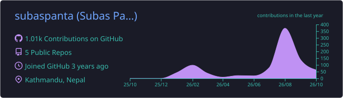

<h1 align="center">Hi, I'm Subas 👋</h1>

  Full-stack web developer from Nepal building thoughtful, practical digital experiences.

## About

- Full-stack web developer focused on building useful web products and polished user experiences.
- I enjoy turning ideas into functional, scalable, and maintainable applications.
- Currently strengthening my fundamentals in web architecture, product thinking, and clean engineering.
- I learn by building, iterating, breaking things, and understanding why they work.

## What I do

- Build responsive and accessible web apps with a focus on usability and performance.
- Design and develop end-to-end solutions using modern JavaScript and TypeScript tools.
- Work across frontend and backend to create practical, real-world products.
- Improve developer workflows, product quality, and system clarity through thoughtful implementation.

## Tech Stack

  

## Currently exploring

- Product-focused engineering and better problem solving
- Frontend architecture and performance optimization
- Backend systems, APIs, and scalable app design
- Clean workflows, testing, and maintainable codebases

## My approach

I like building software that feels simple on the surface but is solid underneath. I care about clarity, speed, and creating experiences that people can actually enjoy using.

## Streak

## Contribution Graph

